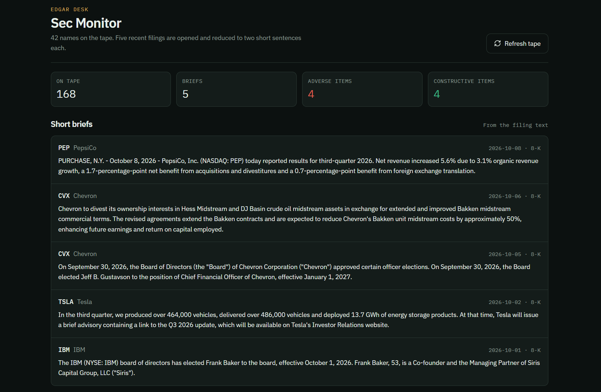
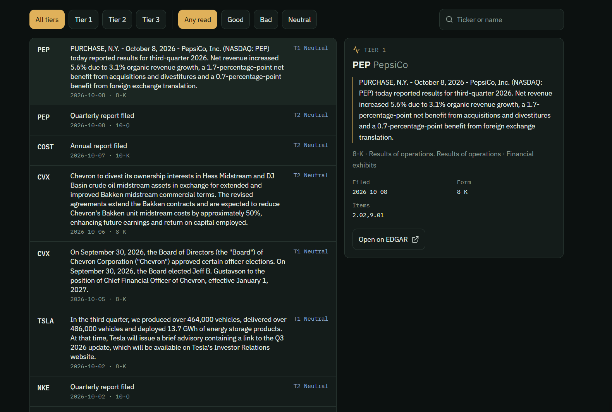

# SEC Monitor

[繁體中文](#繁體中文) | [English](#english)

> An SEC filing monitoring dashboard for tracking recent company disclosures and reviewing potentially material events.

---

## 繁體中文

### 專案簡介

SEC Monitor 是一個用於追蹤美國證券交易委員會（SEC）EDGAR 最新公司申報文件的網頁應用程式。使用者可以查看監察名單內公司的最新申報紀錄、公司名稱、股票代號、申報表格類型、提交日期及原始 SEC 文件連結。

此專案的目標是把原本分散、需要人手搜尋的 SEC 公司申報資訊，整理成較容易閱讀和追蹤的介面，協助使用者更快發現可能值得進一步研究的公司事件。

> **免責聲明：** 本專案僅供學習、研究及資訊整理用途，不構成投資建議、交易建議或任何財務建議。使用者應自行核實 SEC 原始文件及作出獨立判斷。

### 主要功能

- 追蹤監察名單內公司的近期 SEC 申報文件
- 從 SEC EDGAR 資料來源取得公司申報資料
- 顯示股票代號、公司名稱、表格類型、提交日期及文件連結
- 支援查看 SEC 原始申報文件
- 提供清晰的網頁 dashboard，方便瀏覽近期事件
- 以 Tier 1、Tier 2、Tier 3 對申報事件進行優先級分類
- 支援本地開發及 Vercel 部署設定

### 運作流程

```text
SEC EDGAR 資料來源
        ↓
讀取監察名單公司的近期申報資料
        ↓
整理表格類型、日期、公司及文件連結
        ↓
依規則進行 Tier 優先級分類
        ↓
在 SEC Monitor dashboard 顯示結果
        ↓
使用者開啟原始 SEC 文件作進一步核實
```

### 如何在本機執行

#### 需求

- Node.js
- npm
- 網路連線，以讀取 SEC EDGAR 資料

#### 安裝

先開啟 Command Prompt 或 PowerShell，然後進入專案資料夾：

```bash
cd C:\Users\user\Desktop\sec_monitor_new
```

安裝套件：

```bash
npm install
```

啟動本地開發伺服器：

```bash
npx vite --host 0.0.0.0 --port 8080
```

然後在瀏覽器開啟：

```text
http://localhost:8080
```

如你已修正 `package.json` 內的 `dev` script，亦可以使用：

```bash
npm run dev
```

### 如何使用

1. 啟動本地伺服器後，開啟 `http://localhost:8080`
2. 在 dashboard 查看最新 SEC 申報紀錄
3. 透過公司名稱、股票代號、表格類型或日期辨識相關事件
4. 按 SEC 文件連結，查看及核實原始申報內容
5. 將高優先級事件作進一步研究；不要只根據 dashboard 資訊作投資決定

### 截圖

#### Dashboard 總覽



#### 申報文件詳情



> 請將你的截圖放到 `screenshots/` 資料夾，並確保檔案名稱與上面的 Markdown 路徑一致。

### 技術架構

- React / TypeScript
- Vite
- SEC EDGAR submissions API
- HTML / CSS
- Vercel deployment configuration

### 資料來源與限制

本專案使用 SEC EDGAR 公開資料。SEC 文件可能包含複雜、法律性或需要專業判讀的內容；dashboard 的分類與顯示只用於協助篩選和閱讀，不能取代閱讀原始文件或專業財務意見。

自動存取 SEC EDGAR 時，應使用清楚的 User-Agent、有效率地查詢資料，並遵守 SEC 的存取規範。

---

## English

### Overview

SEC Monitor is a web application for tracking recent company filings published through the U.S. Securities and Exchange Commission (SEC) EDGAR system. It helps users review recent filings for companies in a watchlist, including the company name, ticker, filing form, filing date, priority tier, and a link to the original SEC document.

The project aims to turn scattered SEC filing information into a clearer monitoring dashboard, helping users identify company events that may deserve further research.

> **Disclaimer:** This project is for learning, research, and information-organising purposes only. It is not investment, trading, or financial advice. Always verify information using the original SEC filing and make independent decisions.

### Features

- Tracks recent SEC filings for companies in a watchlist
- Retrieves filing data from SEC EDGAR sources
- Displays ticker, company name, filing form, filing date, and source-document link
- Links users to the original SEC filing for verification
- Provides a readable web dashboard for reviewing recent events
- Categorises filings into Tier 1, Tier 2, and Tier 3 priority levels
- Includes local development and Vercel deployment configuration

### How It Works

```text
SEC EDGAR data source
        ↓
Retrieve recent filings for watchlist companies
        ↓
Extract filing type, date, company details, and source link
        ↓
Apply rule-based tier classification
        ↓
Display results in the SEC Monitor dashboard
        ↓
Open the original SEC document for verification
```

### Run Locally

#### Prerequisites

- Node.js
- npm
- Internet access for SEC EDGAR data

#### Installation

Open Command Prompt or PowerShell and move into the project directory:

```bash
cd C:\Users\user\Desktop\sec_monitor_new
```

Install dependencies:

```bash
npm install
```

Start the local development server:

```bash
npx vite --host 0.0.0.0 --port 8080
```

Open the application in a browser:

```text
http://localhost:8080
```

If the `dev` script in `package.json` has been fixed, you can instead run:

```bash
npm run dev
```

### Usage

1. Start the local server and open `http://localhost:8080`
2. Review the latest filing records on the dashboard
3. Identify relevant events by company, ticker, form type, date, or priority tier
4. Open the SEC source link to read and verify the original document
5. Use high-priority events as research prompts only; do not make investment decisions from the dashboard alone

### Screenshots

#### Dashboard Overview


#### Filing Detail


Place your screenshots inside the `screenshots/` folder and make sure their filenames match the paths above.

### Tech Stack

- React / TypeScript
- Vite
- SEC EDGAR submissions API
- HTML / CSS
- Vercel deployment configuration

### Data Source and Limitations

This application uses public SEC EDGAR data. SEC filings can be complex, legal, and context-dependent. The dashboard’s tier classification and display are designed to help with filtering and review; they do not replace reading original filings or receiving professional financial advice.

When accessing SEC EDGAR programmatically, use a descriptive User-Agent, make efficient requests, and follow SEC access policies.

---
